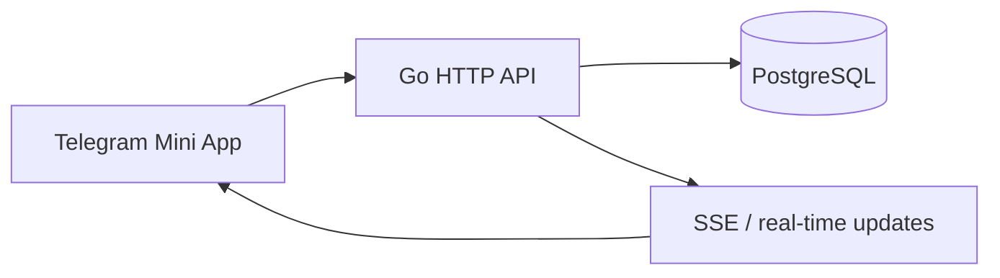

<table>
<tr>
<td width="72%" valign="middle">

# Daniil Isaverdov

### Go Backend Developer

I build backend APIs and real-time features with **Go** and **PostgreSQL**.

**Focus:** concurrency · data consistency · reliability

</td>
<td width="28%" align="center" valign="middle">

</td>
</tr>
</table>

### About

I'm a Go backend developer contributing to a product built by a **6-person team**. I work on HTTP APIs, PostgreSQL data models, and concurrent and real-time functionality.

Currently studying at **ITHub** and **School 21** (C → Go). Open to **Junior Go Backend Developer** opportunities.

### Engineering experience

**Gouve** · Go Backend Developer · `Aug 2026 – present`  
*Telegram bot and Mini App for time, task, and habit tracking*

<table>
<tr>
<td width="50%" valign="top">

**Concurrency & consistency**

Kanban board ordering with transactions and `SELECT FOR UPDATE`. SQL data modeling, partial indexes, and atomic numbering.

</td>
<td width="50%" valign="top">

**Real-time systems**

SSE updates, pub/sub, and buffered Go channels, without holding database connections open for active streams.

</td>
</tr>
<tr>
<td width="50%" valign="top">

**HTTP debugging**

Found an export-streaming issue in middleware missing `Unwrap()`, preventing proper flushing and write-deadline handling.

</td>
<td width="50%" valign="top">

**Time-aware backend**

User time zones, calendar boundaries, activity statistics, and tests for date edge cases.

</td>
</tr>
</table>

Team workflow: task tracking · feature branches · pull requests · code review

### Tech stack

  

| Backend | Data | Infrastructure |
| :--- | :--- | :--- |
| Go · `net/http` · chi | PostgreSQL · pgx | Docker Compose · Linux |
| REST · SSE · goroutines | SQL · transactions | Nginx · GitHub Actions |
| Table-driven tests | Migrations · indexes | Git · pull requests |

### How the pieces fit together

<b>Currently exploring</b>

Go internals, system design, observability, and performance optimization.

---

Projects and code are available in the pinned repositories below. 
Go Gopher artwork by <a href="https://go.dev/blog/gopher">Renée French</a>, CC BY 4.0.

